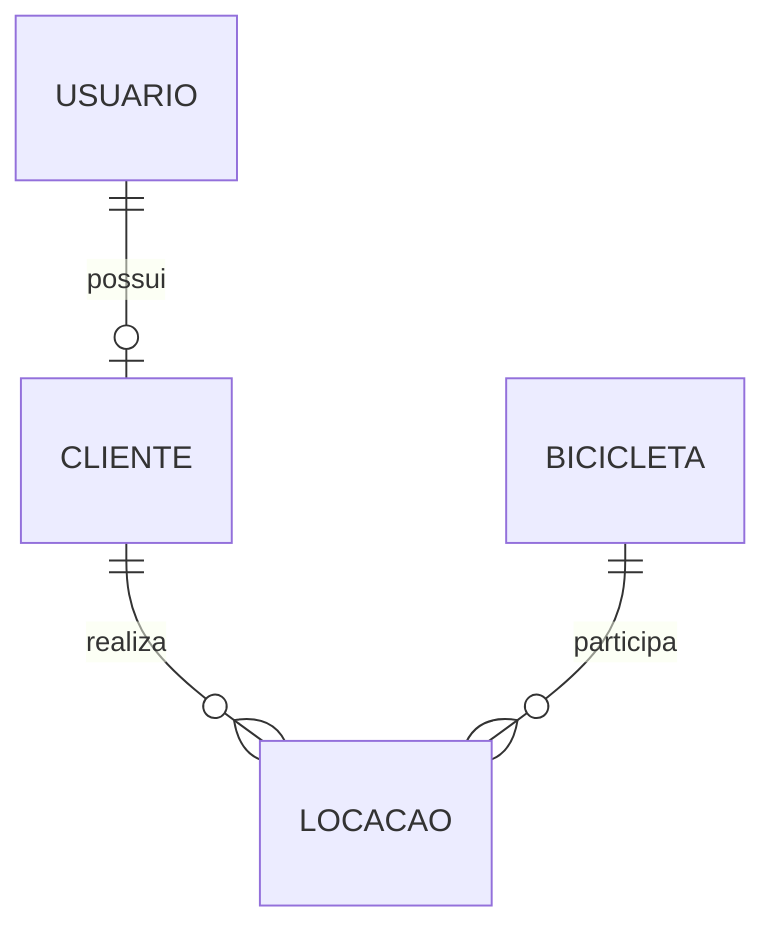

# Bikes — Locadora de Bicicletas

[](https://github.com/lcsrj/bikes-testes-alteracao-senha/actions/workflows/tests.yml)

API REST para gerenciamento de uma locadora de bicicletas. Permite cadastrar usuários e clientes, administrar a frota, solicitar locações, registrar devoluções, calcular valores e consultar relatórios.

O projeto final dá continuidade às atividades anteriores e implementa os requisitos **4, 5, 6, 7 e 8**, com autenticação JWT, controle de acesso, auditoria, validação e documentação OpenAPI 3.1 / Swagger 3.

## Sumário

- [Visão geral](#visão-geral)
- [Requisitos e atividades](#requisitos-e-atividades)
- [Tecnologias](#tecnologias)
- [Arquitetura e estrutura](#arquitetura-e-estrutura)
- [Modelo de dados](#modelo-de-dados)
- [Pré-requisitos](#pré-requisitos)
- [Instalação e execução](#instalação-e-execução)
- [Configurações e variáveis de ambiente](#configurações-e-variáveis-de-ambiente)
- [Autenticação e perfis de acesso](#autenticação-e-perfis-de-acesso)
- [Catálogo de endpoints](#catálogo-de-endpoints)
- [Requisições e respostas](#requisições-e-respostas)
- [Fluxo completo no PowerShell](#fluxo-completo-no-powershell)
- [Regras de negócio e estados](#regras-de-negócio-e-estados)
- [Tarifas e cálculo da cobrança](#tarifas-e-cálculo-da-cobrança)
- [Validação dos campos](#validação-dos-campos)
- [Auditoria e concorrência](#auditoria-e-concorrência)
- [Erros e códigos HTTP](#erros-e-códigos-http)
- [Swagger e OpenAPI](#swagger-e-openapi)
- [Testes](#testes)
- [Build e distribuição](#build-e-distribuição)
- [Integração contínua](#integração-contínua)
- [Solução de problemas](#solução-de-problemas)
- [Escopo e limitações](#escopo-e-limitações)
- [Contribuição](#contribuição)

## Visão geral

O sistema atende a dois perfis:

| Perfil | Responsabilidades |
| --- | --- |
| CLIENTE | Cadastrar os próprios dados, solicitar bicicletas, consultar suas locações e registrar devoluções |
| ADMIN | Administrar a frota, consultar usuários e clientes, acompanhar locações, registrar devoluções e emitir o relatório geral |

O fluxo principal é:

```text
Cadastro de usuário → Login → Cadastro de cliente → Locação → Devolução → Relatório
```

A frota é cadastrada por ADMIN. Quando uma locação é confirmada, a bicicleta passa de LIVRE para OCUPADA. Na devolução, ela volta a LIVRE ou é encaminhada para MANUTENCAO.

**Endereços padrão:**

| Serviço | Endereço |
| --- | --- |
| Base da API | `http://localhost:8080/api/v1` |
| Swagger UI | [http://localhost:8080/docs-bikes.html](http://localhost:8080/docs-bikes.html) |
| OpenAPI JSON | [http://localhost:8080/docs-bikes](http://localhost:8080/docs-bikes) |

## Requisitos e atividades

### Projeto final

| Requisito | Funcionalidades implementadas |
| --- | --- |
| 4 — Cliente | Cadastro autenticado com nome completo e CPF único; relacionamento de um cliente por usuário; consulta dos próprios dados e consultas administrativas |
| 5 — Bicicleta | Código único independente do ID; cadastro e consulta por código; estados LIVRE, OCUPADA e MANUTENCAO; operações exclusivas de ADMIN |
| 6 — Locações | Solicitação pelo cliente; verificação de disponibilidade; validação do cartão; registro da retirada e devolução prevista; exclusividade da bicicleta durante a locação |
| 7 — Devoluções | Registro da devolução efetiva; duração e valor; finalização da locação; liberação automática ou encaminhamento para manutenção |
| 8 — Relatório | Listagem de locações e devoluções com nome do cliente, código da bicicleta, datas, duração, status e valor |

A configuração geral também inclui locale `pt_BR`, fuso `America/Sao_Paulo`, auditoria JPA e autenticação JWT.

### Atividades anteriores

| Atividade | Entrega |
| --- | --- |
| 1 — Alteração de senha | Senha atual, nova senha e confirmação; validação dos campos e tratamento de divergências |
| 2 — Testes de alteração de senha | Cenários de sucesso, senha atual incorreta, confirmação diferente, campos inválidos e casos de regressão |
| 3 — Cadastro de Cliente | Entidade, DTOs, mapper, controller, service, repository, CPF único, vínculo com usuário, auditoria e autorização |

A numeração das atividades anteriores é distinta da numeração dos requisitos do projeto final. O cadastro de Cliente, desenvolvido na Atividade 3, corresponde ao requisito 4 do enunciado final.

## Tecnologias

| Tecnologia | Versão ou uso |
| --- | --- |
| Java | Compilação para Java 25; JDK 25 ou superior |
| Spring Boot | 4.1.1 |
| Spring Web MVC | Recursos REST |
| Spring Data JPA / Hibernate | Persistência, relacionamentos e transações |
| Spring Security | Autenticação e autorização |
| OAuth2 Resource Server / Nimbus JOSE JWT | Emissão e validação de JWT com HMAC SHA-256 |
| BCrypt | Hash das senhas |
| Bean Validation / Hibernate Validator | Validação dos DTOs, CPF e cartão |
| MapStruct | 1.6.3; conversão de Usuário e Cliente |
| Lombok | Redução de código repetitivo nas entidades e serviços |
| MySQL | Banco usado na execução normal |
| H2 | Banco em memória para testes |
| SpringDoc | 3.1.1; documento OpenAPI 3.1 e Swagger UI |
| JUnit / AssertJ / Awaitility | Testes e verificações de concorrência |
| WebTestClient / Java HttpClient | Testes HTTP de ponta a ponta |
| Maven Wrapper | Compilação, testes e empacotamento |
| GitHub Actions | Execução da suíte em pushes e pull requests |

As dependências estão em [pom.xml](pom.xml).

## Arquitetura e estrutura

A aplicação usa camadas de controller, service e repository. A API recebe DTOs validados, executa as regras de negócio em serviços e acessa o banco pelos repositórios JPA.

```text
Requisição HTTP
    ↓
Spring Security
    ↓
Controller → DTO e validação
    ↓
Service → autorização, regras de negócio e transações
    ↓
Repository → JPA / Hibernate → Banco de dados
```

```text
src/
├── main/
│   ├── java/br/edu/ifc/bikes/
│   │   ├── config/             # Segurança, JWT, auditoria, fuso e OpenAPI
│   │   ├── dto/                # Requisições e respostas
│   │   │   └── mapper/         # Conversões de Usuário e Cliente
│   │   ├── entity/             # Usuario, Cliente, Bicicleta, Locacao e auditoria
│   │   ├── exception/          # Exceções de negócio
│   │   ├── repository/         # Repositórios JPA e buscas com bloqueio
│   │   ├── security/           # Identificação do usuário autenticado
│   │   ├── service/            # Regras de cada recurso
│   │   └── web/
│   │       ├── controller/     # Endpoints REST
│   │       └── exception/      # Respostas de erro e tratamento global
│   └── resources/
│       └── application.properties
└── test/
    ├── java/br/edu/ifc/bikes/   # Testes unitários e de integração
    └── resources/
        ├── application.properties
        └── sql/usuarios/       # Preparação e limpeza dos dados de teste

.github/workflows/tests.yml     # Pipeline de testes
.mvn/                           # Configuração do Maven Wrapper
mvnw / mvnw.cmd                 # Maven Wrapper para Linux/macOS e Windows
pom.xml                         # Dependências e plugins
```

## Modelo de dados



| Entidade | Campos de negócio |
| --- | --- |
| Usuario | `id`, `username`, `password`, `role` |
| Cliente | `id`, `nome`, `cpf`, `telefone`, `email`, vínculo com `usuario` |
| Bicicleta | `id`, `codigo`, `modelo`, `status` |
| Locacao | `id`, vínculos com `cliente` e `bicicleta`, `dataRetirada`, `dataDevolucaoPrevista`, `dataDevolucao`, `duracaoSegundos`, `valorHora`, `valor`, `cartaoFinal`, `status` |

Todas essas entidades herdam de `EntidadeAuditavel`: `dataCriacao`, `dataModificacao`, `criadoPor` e `modificadoPor`.

Os relacionamentos obrigatórios e as restrições de unicidade são aplicados no banco. Em Locacao, `bicicletaAtiva` é um vínculo adicional e único que existe durante a locação e é liberado na devolução. O vínculo histórico com `bicicleta` é mantido.

Os métodos `equals` e `hashCode` de Cliente, Bicicleta e Locacao usam a identidade da entidade; objetos novos distintos não são considerados iguais apenas por ainda não terem ID.

## Pré-requisitos

| Recurso | Necessidade |
| --- | --- |
| JDK 25 ou superior | Compilar e executar o projeto |
| Git | Clonar e atualizar o repositório |
| MySQL | Executar a aplicação com a configuração normal |
| Acesso à internet | Baixar as dependências na primeira execução |
| Maven instalado separadamente | Dispensável: o projeto inclui Maven Wrapper |
| MySQL para executar testes | Dispensável: os testes usam H2 em memória |
| Python | Opcional, para gerar uma chave JWT com o exemplo abaixo |

Confira o Java antes de iniciar:

```bash
java -version
```

## Instalação e execução

### 1. Clonar o projeto

```bash
git clone https://github.com/lcsrj/bikes-testes-alteracao-senha.git
cd bikes-testes-alteracao-senha
```

Para atualizar um clone existente com a árvore de trabalho limpa:

```bash
git pull --ff-only origin main
```

### 2. Criar o banco

No MySQL:

```sql
CREATE DATABASE IF NOT EXISTS bikes CHARACTER SET utf8mb4;
```

Configure uma conta do banco com permissão para acessar o schema e criar ou atualizar suas tabelas. O Hibernate usa `spring.jpa.hibernate.ddl-auto=update` na execução normal.

### 3. Configurar e iniciar no Windows

No PowerShell:

```powershell
$env:JAVA_HOME = 'C:\caminho\do\jdk-25'
$env:SPRING_DATASOURCE_URL = 'jdbc:mysql://localhost:3306/bikes'
$env:SPRING_DATASOURCE_USERNAME = 'seu_usuario'
$env:SPRING_DATASOURCE_PASSWORD = 'sua_senha'
$env:BIKES_VALOR_HORA = '10.00'
.\mvnw.cmd spring-boot:run
```

Substitua os valores pelo caminho real do JDK e pelas credenciais do seu banco.

### 4. Configurar e iniciar no Linux ou macOS

```bash
export JAVA_HOME='/caminho/do/jdk-25'
export SPRING_DATASOURCE_URL='jdbc:mysql://localhost:3306/bikes'
export SPRING_DATASOURCE_USERNAME='seu_usuario'
export SPRING_DATASOURCE_PASSWORD='sua_senha'
export BIKES_VALOR_HORA='10.00'
bash mvnw spring-boot:run
```

### 5. Acessar a documentação

Com a aplicação iniciada, abra [Swagger UI](http://localhost:8080/docs-bikes.html). O cadastro de usuário e o login são públicos; as operações de negócio exigem autenticação.

## Configurações e variáveis de ambiente

A configuração principal está em [application.properties](src/main/resources/application.properties).

| Variável de ambiente | Finalidade | Padrão da aplicação |
| --- | --- | --- |
| `SPRING_DATASOURCE_URL` | Conexão JDBC | MySQL em `localhost:3306`, banco `bikes` |
| `SPRING_DATASOURCE_USERNAME` | Usuário do banco | `root`, na configuração local fornecida |
| `SPRING_DATASOURCE_PASSWORD` | Senha do banco | `root`, na configuração local fornecida |
| `BIKES_VALOR_HORA` | Tarifa por hora em reais | `10.00` |
| `BIKES_JWT_SECRET` | Chave JWT em Base64 | Chave temporária gerada em memória |
| `BIKES_JWT_DURACAO` | Validade dos tokens, em ISO-8601 | `PT1H`, equivalente a uma hora |
| `BIKES_TIMEZONE` | Fuso da aplicação | `America/Sao_Paulo` |
| `SERVER_PORT` | Porta HTTP | `8080` |

A tarifa deve ser positiva, ter até duas casas decimais e não exceder `999999.99`. Use ponto como separador decimal na configuração.

As variáveis também podem ser definidas na configuração de execução da IDE. Um arquivo `.env` não é carregado automaticamente pela aplicação.

### Configurar uma chave JWT persistente

Gere pelo menos 32 bytes aleatórios e codifique o resultado em Base64. Exemplo com Python:

```bash
python -c "import secrets, base64; print(base64.b64encode(secrets.token_bytes(32)).decode())"
```

No PowerShell, defina o resultado antes de iniciar a aplicação:

```powershell
$env:BIKES_JWT_SECRET = 'chave_base64_gerada'
$env:BIKES_JWT_DURACAO = 'PT1H'
```

No Linux ou macOS:

```bash
export BIKES_JWT_SECRET='chave_base64_gerada'
export BIKES_JWT_DURACAO='PT1H'
```

Não use o texto literal `chave_base64_gerada`: substitua-o pela saída do comando. Sem essa variável, cada inicialização gera uma nova chave e invalida os tokens emitidos antes do reinício. Instâncias que precisem aceitar os mesmos tokens devem compartilhar a mesma chave.

## Autenticação e perfis de acesso

### Cadastro e login

1. Cadastre a conta em `POST /api/v1/usuarios`.
2. Autentique em `POST /api/v1/auth/login`.
3. Copie o campo `accessToken` da resposta.
4. Envie o cabeçalho abaixo nas operações protegidas:

```http
Authorization: Bearer <accessToken>
```

O JWT é assinado com HMAC SHA-256. A aplicação valida assinatura, emissor e expiração, e consulta o perfil atual do usuário no banco em cada requisição.

Não há criação de sessão HTTP. HTTP Basic continua disponível para compatibilidade, e o desafio de autenticação anuncia Basic e Bearer no cabeçalho `WWW-Authenticate`.

### Criar uma conta administrativa

Não existe conta ADMIN padrão na aplicação. Primeiro cadastre a conta pela API, por exemplo:

```http
POST /api/v1/usuarios
Content-Type: application/json
```

```json
{
  "username": "admin@example.com",
  "password": "123456"
}
```

O cadastro público sempre atribui o perfil CLIENTE. Para preparar o administrador no ambiente de desenvolvimento, execute no banco:

```sql
UPDATE usuarios SET role = 'ADMIN' WHERE username = 'admin@example.com';
```

Em seguida, faça login com essa conta para obter o token usado nas operações administrativas. Enviar um campo `role` no cadastro público não concede o perfil ADMIN.

### Matriz de permissões

| Operação | Público | CLIENTE | ADMIN |
| --- | --- | --- | --- |
| Cadastrar usuário e fazer login | Sim | Sim | Sim |
| Consultar usuário por ID | Não | Própria conta | Qualquer usuário |
| Alterar senha, informando a senha atual | Não | Própria conta | Qualquer usuário |
| Listar usuários | Não | Não | Sim |
| Cadastrar cliente | Não | Próprio cadastro | Não |
| Consultar `/clientes/me` | Não | Próprios dados | Apenas se a conta possuir vínculo de cliente |
| Consultar cliente por ID e listar clientes | Não | Não | Sim |
| Cadastrar, listar, consultar e alterar status de bicicletas | Não | Não | Sim |
| Solicitar locação | Não | Com cadastro de cliente | Não |
| Consultar `/locacoes/me` | Não | Próprias locações | Não |
| Consultar uma locação e registrar devolução | Não | Própria locação | Qualquer locação |
| Consultar relatório geral | Não | Não | Sim |

### Alteração de senha e tokens

As senhas são armazenadas com BCrypt. Depois de uma alteração, HTTP Basic e novos logins devem usar a nova senha. JWTs já emitidos continuam válidos até a expiração enquanto o usuário existir; não há endpoint de logout ou revogação de token.

## Catálogo de endpoints

Todos os caminhos desta seção são relativos à base `http://localhost:8080/api/v1`. Requisições com corpo usam `Content-Type: application/json`.

### Autenticação

| Método | Rota | Acesso | Sucesso |
| --- | --- | --- | --- |
| POST | `/auth/login` | Público | 200 com JWT |

### Usuários

| Método | Rota | Acesso | Sucesso |
| --- | --- | --- | --- |
| POST | `/usuarios` | Público | 201 |
| GET | `/usuarios/{id}` | Próprio usuário ou ADMIN | 200 |
| PATCH | `/usuarios/{id}` | Próprio usuário ou ADMIN, com a senha atual | 204 sem corpo |
| GET | `/usuarios` | ADMIN | 200 com lista |

### Clientes

| Método | Rota | Acesso | Sucesso |
| --- | --- | --- | --- |
| POST | `/clientes` | CLIENTE autenticado | 201 e cabeçalho `Location` |
| GET | `/clientes/me` | Usuário autenticado com vínculo de cliente | 200 |
| GET | `/clientes/{id}` | ADMIN | 200 |
| GET | `/clientes` | ADMIN | 200 com lista |

### Bicicletas

| Método | Rota | Acesso | Sucesso |
| --- | --- | --- | --- |
| POST | `/bicicletas` | ADMIN | 201 e cabeçalho `Location` |
| GET | `/bicicletas` | ADMIN | 200 com lista |
| GET | `/bicicletas/{codigo}` | ADMIN | 200 |
| PATCH | `/bicicletas/{codigo}/status` | ADMIN | 200 |

### Locações

| Método | Rota | Acesso | Sucesso |
| --- | --- | --- | --- |
| POST | `/locacoes` | CLIENTE cadastrado | 201 e cabeçalho `Location` |
| GET | `/locacoes/me` | CLIENTE | 200 com as próprias locações |
| GET | `/locacoes/{id}` | Próprio cliente ou ADMIN | 200 |

### Devoluções

| Método | Rota | Acesso | Sucesso |
| --- | --- | --- | --- |
| POST | `/locacoes/{id}/devolucao` | Próprio cliente ou ADMIN | 200 com valor e duração |

### Relatórios

| Método | Rota | Acesso | Sucesso |
| --- | --- | --- | --- |
| GET | `/relatorios/locacoes` | ADMIN | 200 com lista |

O relatório aceita o filtro opcional `status=ATIVA` ou `status=FINALIZADA`. Sem filtro, inclui todas as locações.

## Requisições e respostas

Os IDs, horários e valores abaixo ilustram o contrato da API. IDs são gerados pelo banco; informe datas futuras ao solicitar uma locação.

### Usuário

Cadastro em `POST /usuarios`:

```json
{
  "username": "maria@example.com",
  "password": "123456"
}
```

Resposta 201:

```json
{
  "id": 1,
  "username": "maria@example.com",
  "role": "CLIENTE"
}
```

Alteração de senha em `PATCH /usuarios/1`:

```json
{
  "senhaAtual": "123456",
  "novaSenha": "654321",
  "confirmaSenha": "654321"
}
```

O sucesso retorna 204 sem corpo. Senha atual incorreta ou confirmação diferente retorna 400.

### Login

Envie as credenciais para `POST /auth/login`:

```json
{
  "username": "maria@example.com",
  "password": "123456"
}
```

Resposta 200:

```json
{
  "accessToken": "<JWT emitido pela aplicação>",
  "tokenType": "Bearer",
  "expiresIn": 3600
}
```

### Cliente

Cadastro em `POST /clientes`, autenticado como CLIENTE:

```json
{
  "nome": "Maria da Silva",
  "cpf": "52998224725",
  "telefone": "(49) 99999-9999",
  "email": "maria@example.com"
}
```

Nome e CPF são obrigatórios; telefone e e-mail são opcionais. O usuário associado e a auditoria são definidos pelo servidor.

Resposta 201:

```json
{
  "id": 1,
  "nome": "Maria da Silva",
  "cpf": "52998224725",
  "usuarioId": 1,
  "dataCriacao": "2030-01-01T12:00:00",
  "dataModificacao": "2030-01-01T12:00:00",
  "criadoPor": "maria@example.com",
  "modificadoPor": "maria@example.com",
  "telefone": "(49) 99999-9999",
  "email": "maria@example.com"
}
```

O cliente consulta seus dados por `/clientes/me`. A busca por `/clientes/{id}` é exclusiva de ADMIN.

### Bicicleta

Cadastro em `POST /bicicletas`, autenticado como ADMIN:

```json
{
  "codigo": "BIKE-001",
  "modelo": "Mountain Bike aro 29"
}
```

Resposta 201:

```json
{
  "id": 1,
  "codigo": "BIKE-001",
  "modelo": "Mountain Bike aro 29",
  "status": "LIVRE",
  "dataCriacao": "2030-01-01T12:00:00",
  "dataModificacao": "2030-01-01T12:00:00",
  "criadoPor": "admin@example.com",
  "modificadoPor": "admin@example.com"
}
```

Para encaminhar uma bicicleta livre à manutenção, envie para `PATCH /bicicletas/BIKE-001/status`:

```json
{
  "status": "MANUTENCAO"
}
```

Para liberá-la, envie `LIVRE`. O status OCUPADA é controlado exclusivamente pela locação.

### Locação

Solicitação em `POST /locacoes`, autenticado como CLIENTE cadastrado:

```json
{
  "codigoBicicleta": "BIKE-001",
  "dataDevolucaoPrevista": "2030-01-01T14:00:00",
  "cartao": {
    "titular": "Maria da Silva",
    "numero": "4111111111111111",
    "cvv": "123",
    "mesValidade": 12,
    "anoValidade": 2035
  }
}
```

O código da bicicleta é opcional. Quando omitido, o sistema seleciona uma bicicleta LIVRE. O número mostrado é um cartão de teste.

Resposta 201:

```json
{
  "id": 1,
  "clienteId": 1,
  "nomeCliente": "Maria da Silva",
  "codigoBicicleta": "BIKE-001",
  "dataRetirada": "2030-01-01T12:00:00",
  "dataDevolucaoPrevista": "2030-01-01T14:00:00",
  "dataDevolucao": null,
  "duracaoSegundos": 0,
  "status": "ATIVA",
  "valorHora": 10.00,
  "valor": null,
  "cartaoFinal": "1111"
}
```

O número completo e o CVV não são armazenados nem devolvidos nas respostas. Apenas os quatro últimos dígitos são persistidos.

### Devolução

Envie para `POST /locacoes/1/devolucao`:

```json
{
  "manutencao": false
}
```

Exemplo de resposta 200 após 30 minutos de utilização, com tarifa de R$ 10,00/h:

```json
{
  "id": 1,
  "clienteId": 1,
  "nomeCliente": "Maria da Silva",
  "codigoBicicleta": "BIKE-001",
  "dataRetirada": "2030-01-01T12:00:00",
  "dataDevolucaoPrevista": "2030-01-01T14:00:00",
  "dataDevolucao": "2030-01-01T12:30:00",
  "duracaoSegundos": 1800,
  "status": "FINALIZADA",
  "valorHora": 10.00,
  "valor": 5.00,
  "cartaoFinal": "1111"
}
```

Com `manutencao: true`, a bicicleta passa para MANUTENCAO em vez de LIVRE. Uma locação finalizada não pode ser devolvida novamente.

### Relatório

Consulta administrativa: `GET /relatorios/locacoes?status=FINALIZADA`.

Exemplo de resposta 200:

```json
[
  {
    "locacaoId": 1,
    "nomeCliente": "Maria da Silva",
    "codigoBicicleta": "BIKE-001",
    "dataRetirada": "2030-01-01T12:00:00",
    "dataDevolucaoPrevista": "2030-01-01T14:00:00",
    "dataDevolucao": "2030-01-01T12:30:00",
    "duracaoSegundos": 1800,
    "status": "FINALIZADA",
    "valor": 5.00
  }
]
```

Nas locações ATIVAS, `dataDevolucao` e `valor` permanecem nulos. A duração é calculada até o instante da consulta.

## Fluxo completo no PowerShell

Execute com a aplicação iniciada e com a conta `admin@example.com` preparada conforme a seção de autenticação. Use usuário, CPF e código ainda não cadastrados: repetir os cadastros retorna 409.

```powershell
$api = 'http://localhost:8080/api/v1'

# Cadastrar o usuário cliente
$usuarioBody = @{ username = 'maria@example.com'; password = '123456' } | ConvertTo-Json
Invoke-RestMethod -Method Post -Uri "$api/usuarios" -ContentType 'application/json' -Body $usuarioBody

# Obter o token do cliente
$clienteLogin = Invoke-RestMethod -Method Post -Uri "$api/auth/login" -ContentType 'application/json' -Body $usuarioBody
$clienteHeaders = @{ Authorization = "Bearer $($clienteLogin.accessToken)" }

# Cadastrar os dados do cliente
$clienteBody = @{ nome = 'Maria da Silva'; cpf = '52998224725' } | ConvertTo-Json
Invoke-RestMethod -Method Post -Uri "$api/clientes" -Headers $clienteHeaders -ContentType 'application/json' -Body $clienteBody

# Obter o token administrativo
$adminBody = @{ username = 'admin@example.com'; password = '123456' } | ConvertTo-Json
$adminLogin = Invoke-RestMethod -Method Post -Uri "$api/auth/login" -ContentType 'application/json' -Body $adminBody
$adminHeaders = @{ Authorization = "Bearer $($adminLogin.accessToken)" }

# Cadastrar uma bicicleta
$bicicletaBody = @{ codigo = 'BIKE-001'; modelo = 'Mountain Bike aro 29' } | ConvertTo-Json
Invoke-RestMethod -Method Post -Uri "$api/bicicletas" -Headers $adminHeaders -ContentType 'application/json' -Body $bicicletaBody

# Solicitar locação; a data deve usar o mesmo fuso configurado na aplicação
$locacaoBody = @{
    codigoBicicleta = 'BIKE-001'
    dataDevolucaoPrevista = (Get-Date).AddHours(2).ToString('yyyy-MM-ddTHH:mm:ss')
    cartao = @{
        titular = 'Maria da Silva'
        numero = '4111111111111111'
        cvv = '123'
        mesValidade = 12
        anoValidade = (Get-Date).Year + 2
    }
} | ConvertTo-Json -Depth 3
$locacao = Invoke-RestMethod -Method Post -Uri "$api/locacoes" -Headers $clienteHeaders -ContentType 'application/json' -Body $locacaoBody

# Consultar as próprias locações
Invoke-RestMethod -Method Get -Uri "$api/locacoes/me" -Headers $clienteHeaders

# Registrar devolução
$devolucaoBody = @{ manutencao = $false } | ConvertTo-Json
Invoke-RestMethod -Method Post -Uri "$api/locacoes/$($locacao.id)/devolucao" -Headers $clienteHeaders -ContentType 'application/json' -Body $devolucaoBody

# Consultar o relatório administrativo
Invoke-RestMethod -Method Get -Uri "$api/relatorios/locacoes" -Headers $adminHeaders
```

A devolução imediata no exemplo está sujeita à cobrança mínima. Para conferir a negociação HTTP Basic com cURL:

```bash
curl --anyauth -u admin@example.com:123456 http://localhost:8080/api/v1/bicicletas
```

No PowerShell, use `curl.exe` caso `curl` seja um alias para outro comando.

## Regras de negócio e estados

### Usuário e Cliente

- O e-mail de login é único; a senha possui exatamente seis caracteres.
- O cadastro público cria contas CLIENTE.
- Um usuário pode ter somente um cliente, e cada cliente pertence a um único usuário.
- O CPF é único e deve ser válido.
- O vínculo do cliente é obtido da autenticação; não pode ser escolhido pelo corpo da requisição.
- Somente CLIENTE pode realizar seu cadastro de cliente.
- A consulta de Cliente por ID e a listagem geral são exclusivas de ADMIN.

### Bicicleta

| Estado | Significado | Transição |
| --- | --- | --- |
| LIVRE | Disponível para uma locação | Passa a OCUPADA por locação ou a MANUTENCAO por ADMIN |
| OCUPADA | Participa de uma locação ativa | Passa a LIVRE ou MANUTENCAO pela devolução |
| MANUTENCAO | Indisponível para aluguel | Passa a LIVRE após liberação por ADMIN |

O código é diferente do identificador interno, é único e é normalizado para maiúsculas. ADMIN não pode definir OCUPADA manualmente nem liberar uma bicicleta que ainda possui locação ativa.

### Locação e devolução

| Estado | Significado |
| --- | --- |
| ATIVA | Bicicleta retirada, sem devolução efetiva e sem valor final |
| FINALIZADA | Devolução registrada, com duração e valor final |

Uma locação exige cliente cadastrado, bicicleta disponível, cartão válido e previsão posterior à retirada. A mesma bicicleta não pode participar de duas locações ativas. O cliente não pode consultar ou devolver locações de outra pessoa. A devolução efetiva pode ocorrer antes ou depois da previsão; o valor considera o tempo real de uso.

## Tarifas e cálculo da cobrança

O enunciado não define uma tarifa. A aplicação adota R$ 10,00 por hora como padrão, configurável por `BIKES_VALOR_HORA`.

A tarifa é armazenada na retirada. Alterar a configuração para locações futuras não altera a tarifa já registrada nas locações existentes.

```text
duracaoSegundos = segundos completos entre retirada e devolução efetiva
valor = valorHora × max(60, duracaoSegundos) ÷ 3600
```

O cálculo usa `BigDecimal`, arredondamento `HALF_UP` e duas casas decimais. A cobrança mínima corresponde a 60 segundos.

| Uso efetivo | Valor com tarifa de R$ 10,00/h |
| --- | ---: |
| Devolução imediata | R$ 0,17 |
| 15 minutos | R$ 2,50 |
| 30 minutos | R$ 5,00 |
| 1 hora | R$ 10,00 |
| 2 horas | R$ 20,00 |

O tempo aguardando o bloqueio da bicicleta não entra na duração nem no valor. O sistema apresenta o valor a debitar; não realiza cobrança bancária.

## Validação dos campos

| Recurso ou campo | Regra |
| --- | --- |
| Usuário / `username` | Obrigatório, formato de e-mail e único |
| Usuário / `password` | Obrigatório, não pode conter apenas espaços e deve ter seis caracteres |
| Alteração de senha | Três campos obrigatórios de seis caracteres; senha atual confere; nova senha e confirmação iguais |
| Cliente / `nome` | Obrigatório; de 2 a 100 caracteres após retirar espaços nas extremidades |
| Cliente / `cpf` | Obrigatório; 11 dígitos sem pontuação, dígitos verificadores válidos e único |
| Cliente / `telefone` | Opcional; de 8 a 20 caracteres entre números, espaços, `+`, parênteses e hífen |
| Cliente / `email` | Opcional; formato de e-mail e até 100 caracteres |
| Bicicleta / `codigo` | Obrigatório; de 3 a 30 caracteres; letras, números, `_` e `-`; único |
| Bicicleta / `modelo` | Obrigatório; de 2 a 100 caracteres |
| Alteração de status | Status obrigatório; somente LIVRE ou MANUTENCAO pode ser definido manualmente |
| Locação / `codigoBicicleta` | Opcional; mesmo formato do código de bicicleta |
| Locação / `dataDevolucaoPrevista` | Obrigatória e posterior ao horário efetivo da retirada |
| Locação / `cartao` | Obrigatório; campos internos também validados |
| Cartão / `titular` | Obrigatório; de 2 a 100 caracteres |
| Cartão / `numero` | De 13 a 19 dígitos, com verificação do número do cartão |
| Cartão / `cvv` | Obrigatório; 3 ou 4 dígitos |
| Cartão / validade | Mês de 1 a 12, ano de 2000 a 9999 e cartão não vencido no momento da retirada |

As datas de negócio usam o fuso configurado na aplicação. Envie datas no formato ISO-8601, como `2030-01-01T14:00:00`, sem acrescentar um fuso diferente ao exemplo.

## Auditoria e concorrência

### Auditoria

| Campo | Preenchimento |
| --- | --- |
| `dataCriacao` | Horário da criação |
| `dataModificacao` | Horário da última modificação |
| `criadoPor` | Nome do usuário autenticado responsável pela criação |
| `modificadoPor` | Nome do usuário autenticado responsável pela última alteração |

O Spring Data JPA preenche esses campos automaticamente. No cadastro público de usuário, o auditor é `sistema`. As datas de auditoria são normalizadas em microssegundos para manter consistência entre o cadastro e as consultas ao banco.

### Exclusividade das operações

- A reserva, a devolução e a alteração de status usam transações.
- Buscas de escrita bloqueiam a bicicleta ou a locação enquanto a operação é executada.
- O vínculo único `bicicleta_ativa_id` impede outra locação ativa da mesma bicicleta no banco.
- Na devolução, o vínculo ativo é liberado e o histórico permanece preservado.
- O horário de retirada é capturado após obter o bloqueio.
- A previsão e a validade do cartão são verificadas nesse mesmo instante.
- Duas devoluções simultâneas não podem finalizar a mesma locação duas vezes.

## Erros e códigos HTTP

| Código | Significado na API |
| --- | --- |
| 200 | Consulta, login, alteração de status ou devolução concluída |
| 201 | Recurso criado |
| 204 | Senha atualizada; resposta sem corpo |
| 400 | JSON, enum ou formato inválido; também divergência de senhas |
| 401 | Autenticação ausente, credenciais inválidas ou JWT inválido/expirado |
| 403 | Perfil sem permissão ou tentativa de acessar dados de outra pessoa |
| 404 | Recurso não encontrado ou conta sem cadastro de cliente nas consultas correspondentes |
| 409 | Duplicidade, bicicleta indisponível, falta de cadastro de cliente para locação ou locação já finalizada |
| 422 | Campos inválidos, cartão vencido ou previsão inválida |

As respostas de erro seguem `ErrorMessage`, com caminho, método, status, descrição e mensagem. Nas falhas de validação, o objeto `errors` informa os campos inválidos.

Exemplo: cadastro de usuário sem senha.

```json
{
  "path": "/api/v1/usuarios",
  "method": "POST",
  "status": 422,
  "statusMessage": "Unprocessable Content",
  "message": "Campo(s) inválido(s)",
  "errors": {
    "password": "A senha é obrigatória"
  }
}
```

## Swagger e OpenAPI

A documentação é pública e não exige autenticação para ser aberta:

- [Swagger UI](http://localhost:8080/docs-bikes.html).
- [OpenAPI JSON](http://localhost:8080/docs-bikes).

Para testar operações protegidas:

1. Execute o cadastro de usuário, se necessário.
2. Faça login na categoria **Autenticação**.
3. Copie o valor de `accessToken`.
4. Clique em **Authorize**, selecione `bearerAuth` e informe somente o token.
5. Execute as operações permitidas para o perfil da conta.

Os recursos estão organizados em categorias de Usuários, Clientes, Bicicletas, Locações e devoluções e Relatórios. Os contratos completos dos DTOs e os códigos de resposta podem ser consultados no Swagger.

## Testes

Os testes de integração usam HTTP real, portas aleatórias e banco H2 em memória. Não é necessário configurar MySQL para executar a suíte. Os dados são preparados e removidos por scripts SQL.

### Executar todos os testes

Windows:

```powershell
.\mvnw.cmd -B -ntp clean verify
```

Linux ou macOS:

```bash
bash mvnw -B -ntp clean verify
```

### Executar uma classe

```powershell
.\mvnw.cmd -B -ntp test '-Dtest=LocadoraIT'
.\mvnw.cmd -B -ntp test '-Dtest=UsuarioSenhaTest'
```

No Linux ou macOS, substitua `.\mvnw.cmd` por `bash mvnw`.

### Cobertura funcional

| Classe | Testes | Principais cenários |
| --- | ---: | --- |
| `UsuarioIT` | 5 | Cadastro, duplicidade, validação e consulta de usuários |
| `UsuarioSenhaTest` | 24 | Sucesso, senha atual incorreta, confirmação diferente, campos inválidos e regressão da troca de senha |
| `ClienteIT` | 37 | Vínculo, CPF, validação, auditoria, permissão, unicidade no banco e documentação |
| `ClienteTest` | 2 | Contrato de igualdade e estabilidade do hash |
| `LocadoraIT` | 54 | JWT, Basic, perfis, frota, locação, cartão, devolução, valores, manutenção, relatório, concorrência e espera por bloqueio |
| **Total** | **122** | |

A última suíte validada passou com **122 testes, sem falhas, erros ou testes ignorados**. Os relatórios ficam em `target/surefire-reports/`.

As verificações de duração usam relógio controlado. Os testes de bloqueio aguardam uma transação realmente bloqueada e avançam esse relógio para verificar o horário registrado, a cobrança e o vencimento das datas durante a espera.

### Dados de teste

Os scripts de teste criam usuários conhecidos, com senha inicial `123456` armazenada como BCrypt:

| ID | Usuário | Perfil |
| --- | --- | --- |
| 100 | `jose@gmail.com` | ADMIN |
| 101 | `maria@gmail.com` | CLIENTE |
| 102 | `joao@gmail.com` | CLIENTE |

Essas contas pertencem ao ambiente de testes. Elas não são criadas automaticamente no banco da aplicação normal.

## Build e distribuição

Para compilar, testar e gerar o pacote:

```powershell
.\mvnw.cmd -B -ntp clean verify
```

Artefato executável:

```text
target/bikes-0.0.1-SNAPSHOT.jar
```

Com as variáveis de conexão configuradas e o MySQL disponível:

```bash
java -jar target/bikes-0.0.1-SNAPSHOT.jar
```

O pacote contém a aplicação e suas dependências. Não é necessário instalar um servidor de aplicações separado.

## Integração contínua

O workflow [tests.yml](.github/workflows/tests.yml) executa em:

- Pushes.
- Pull requests.
- Execução manual pelo GitHub Actions.

A pipeline prepara Java 25, usa cache do Maven, executa `clean verify` e disponibiliza os relatórios de teste como artefato `relatorios-testes`, inclusive quando a etapa de testes falha.

As execuções podem ser acompanhadas na aba [Actions](https://github.com/lcsrj/bikes-testes-alteracao-senha/actions).

## Solução de problemas

| Problema | O que conferir |
| --- | --- |
| `release version 25 not supported` | Use JDK 25 ou superior e ajuste `JAVA_HOME`; confira `java -version` |
| `JAVA_HOME` aponta para um diretório inválido | Informe a pasta do JDK, sem acrescentar `bin` ao final |
| Falha de conexão com MySQL | Confira o serviço, a porta, o banco `bikes`, as credenciais e a URL JDBC |
| Banco `bikes` não existe | Execute o comando de criação do banco antes de iniciar a aplicação |
| Tabelas não são criadas | Confira as permissões da conta no schema e a propriedade `spring.jpa.hibernate.ddl-auto` |
| Porta 8080 ocupada | Encerre a aplicação que está usando a porta ou defina `SERVER_PORT`, por exemplo `8081` |
| 401 em uma operação protegida | Confira o cabeçalho `Authorization`, a validade do JWT e as credenciais usadas no login |
| JWT deixou de funcionar após reiniciar | Sem chave persistente, o reinício gera outra chave; obtenha novo token ou configure `BIKES_JWT_SECRET` |
| Erro ao inicializar a chave JWT | Use Base64 válido que represente pelo menos 32 bytes aleatórios |
| Usuário antigo não autentica | Senhas antigas em texto puro precisam ser migradas para BCrypt; em base descartável, recrie a conta pela API |
| 403 em cadastro de bicicleta ou relatório | Use uma conta ADMIN; o cadastro público sempre cria CLIENTE |
| 403 em `/clientes/{id}` | Essa rota é administrativa; o cliente deve usar `/clientes/me` |
| 409 ao cadastrar novamente | E-mail, CPF, usuário vinculado e código de bicicleta possuem restrições de unicidade |
| 409 ao solicitar locação | Confira cadastro de cliente e existência de bicicleta LIVRE |
| 409 ao devolver | Confira se a locação já está FINALIZADA |
| 422 na locação | Confira cartão, formato do código e previsão posterior ao horário da retirada |
| Bicicleta permanece indisponível após devolver | Verifique se a devolução foi registrada com `manutencao: true`; ADMIN precisa liberar o status |
| Valor de uma devolução imediata é R$ 0,17 | A tarifa padrão aplica cobrança mínima de um minuto |
| Swagger abre, mas uma operação falha | Abra a resposta HTTP e confira autenticação, perfil, campos e existência do recurso |

## Escopo e limitações

- O projeto entrega uma API de back-end; não inclui interface de cliente ou painel administrativo de front-end.
- O cartão é validado para a solicitação e o valor é calculado na devolução. Não existe integração com operadora nem débito bancário.
- Número completo e CVV não são persistidos. Apenas os quatro últimos dígitos são registrados na locação.
- Não há fluxo de cancelamento, reserva futura, pagamento externo ou multa separada por atraso.
- Não há refresh token, logout ou revogação individual de JWT; o token possui expiração.
- A aplicação usa MySQL; a suíte de integração é executada com H2.
- Os valores locais de conexão podem ser substituídos por variáveis de ambiente. Para publicação, configure credenciais, chave JWT persistente e acesso por HTTPS.

## Contribuição

Para preparar uma alteração:

1. Atualize a branch principal e crie uma branch para a mudança.
2. Mantenha os contratos de DTO, permissões e regras de negócio coerentes com os recursos existentes.
3. Execute `clean verify`.
4. Atualize o README quando houver mudanças em rotas, configuração ou comportamento.
5. Envie a alteração para revisão com um resumo e o resultado dos testes.
